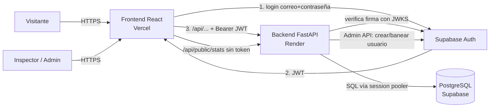

# ARCHITECTURE.md — Diseño técnico del sistema (Índice)
> Se construye sobre `specs/BRIEF.md` v1.0 y `specs/PRD.md` v1.0. El detalle está en `specs/arch/`.
> Versión: **v1.0** — Última actualización: 2026-11-23

---

## 1. Visión técnica
Tres piezas desplegadas por separado, todas en capa gratuita:

| Pieza | Tecnología | Despliegue | Responsabilidad |
|---|---|---|---|
| **Frontend** | React + Vite (JavaScript), React Router, `@supabase/supabase-js` | Vercel | Interfaz; inicia sesión con Supabase Auth y llama al backend con el token |
| **Backend** | Python 3.12, FastAPI, SQLAlchemy 2.0, Alembic, PyJWT, ReportLab | Render (web service) | **Toda** la lógica de negocio, permisos, consultas, cifras públicas y PDF |
| **Datos y auth** | Supabase: PostgreSQL + Auth | Supabase | Almacenar datos; emitir y firmar los JWT de sesión |

## 2. Diagrama de alto nivel



## 3. Principios técnicos
| # | Principio | Por qué |
|---|---|---|
| P-1 | **El frontend nunca toca la base de datos.** Solo usa Supabase para el login | Un solo lugar para reglas y permisos (RNF-02); evita duplicar validaciones en políticas RLS |
| P-2 | **RLS activado sin políticas** en todas las tablas de `public` | Si alguien usa la clave pública de Supabase contra PostgREST, no obtiene nada. El backend se conecta con un rol de BD que salta RLS |
| P-3 | **Las reglas de negocio se prueban en el backend** con pytest sobre PostgreSQL real (CI) | RNF-06; los índices únicos y las consultas dependen de PostgreSQL, SQLite no sirve de sustituto |
| P-4 | **Lo que se puede derivar no se digita** (edad, rango, sticker vigente) | RN-02, RN-07 |
| P-5 | **Configuración solo por variables de entorno** | CLAUDE.md; el repositorio es público |
| P-6 | **Sin dependencias que no paguen su costo** en 7 días | Nada de gestores de estado, ORMs en el frontend ni colas |

## 4. Índice de `specs/arch/`
| Archivo | Contenido |
|---|---|
| [`DATA-MODEL.md`](arch/DATA-MODEL.md) | Tablas, catálogos (enums), índices y cómo se implementa cada regla de negocio |
| [`API.md`](arch/API.md) | Endpoints, parámetros de filtro, respuestas y códigos de error |
| [`AUTH.md`](arch/AUTH.md) | Login, verificación del JWT, roles, creación y desactivación de usuarios |
| [`INFRA.md`](arch/INFRA.md) | Despliegue, variables de entorno, CI/CD (YAML) y operación en capa gratuita |
| `ALGORITHMS.md` | Análisis de complejidad (BRIEF §13). Se redacta en la fase final (RF-06-03) |

## 5. Estructura de carpetas definitiva
```
earthquake-damage-registry/
  .github/workflows/ci.yml        ← lint + tests backend + build frontend
  render.yaml                     ← blueprint del backend en Render
  backend/
    app/
      main.py                     ← crea la app FastAPI, CORS, routers
      config.py                   ← Settings (pydantic-settings) desde variables de entorno
      db.py                       ← engine y sesión SQLAlchemy
      auth.py                     ← verificación del JWT y dependencias de rol
      models.py                   ← modelos SQLAlchemy
      enums.py                    ← catálogos (BRIEF §8)
      schemas/                    ← modelos Pydantic de entrada/salida
      routers/                    ← public, me, users, buildings, inspections, people
      services/                   ← reglas de negocio: filtros, duplicados, cifras, edades
      pdf.py                      ← generación del PDF con ReportLab
    alembic/                      ← migraciones
    scripts/
      create_admin.py             ← RF-01-06
      seed.py                     ← RF-06-01 generador de datos ficticios
    tests/
    requirements.txt
    .env.example
  frontend/
    src/
      main.jsx · App.jsx          ← rutas
      lib/supabase.js · lib/api.js
      pages/                      ← Public, Login, Buildings, BuildingDetail, BuildingForm, Users
      components/                 ← StickerBadge, Filters, PeopleTable, DemoBanner…
    .env.example
  specs/
```

## 6. Decisiones de arquitectura
Registradas en `DECISIONS.md`: DEC-004 (acceso a datos), DEC-005 (sticker vigente desnormalizado), DEC-006 (autenticación), DEC-007 (PDF), DEC-008 (frontend en JavaScript).
