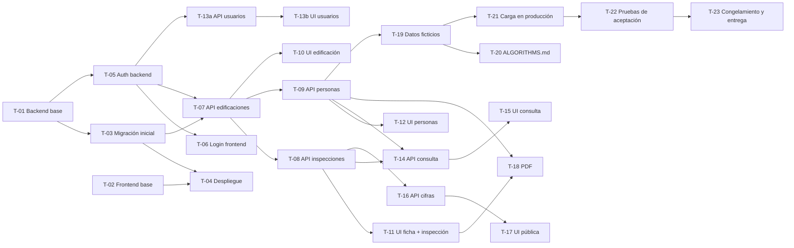

# TASKS.md — Plan de tareas del proyecto
> Índice de fases. El detalle de cada fase está en `specs/tasks/FASE-XX.md`.
> Convención: una tarea = una sesión de agente = una rama = un PR (atómica, verificable, independiente).
> Versión: **v1.0** — Última actualización: 2026-11-23

---

## Estado actual

**Tarea activa:** —
**Fase activa:** FASE-00 (documentación SDD) → cierre
**Próxima tarea:** T-01 Esqueleto del backend (FASE-01)

---

## Fases del proyecto

| Fase | Nombre | Fechas | Archivo | Estado |
|---|---|---|---|---|
| FASE-00 | Documentación SDD | 21-oct – 23-nov | [`tasks/FASE-00.md`](tasks/FASE-00.md) | 🔄 |
| FASE-01 | Esqueleto desplegado y autenticación | 24-nov | [`tasks/FASE-01.md`](tasks/FASE-01.md) | ⬜ |
| FASE-02 | Registro: edificaciones, inspecciones, personas, usuarios | 25 – 26-nov | [`tasks/FASE-02.md`](tasks/FASE-02.md) | ⬜ |
| FASE-03 | Consulta, área pública y PDF | 27-nov | [`tasks/FASE-03.md`](tasks/FASE-03.md) | ⬜ |
| FASE-04 | Datos ficticios, calidad y entrega | 28 – 30-nov | [`tasks/FASE-04.md`](tasks/FASE-04.md) | ⬜ |

---

## Carriles de trabajo (6 integrantes)
Cada integrante toma un carril para trabajar en paralelo sin pisarse. Los nombres se asignan en la reunión del equipo.

| Carril | Responsable | Tareas |
|---|---|---|
| **A — Backend núcleo** | *por asignar* | T-01, T-07, T-08, T-14 |
| **B — Backend personas y auth** | *por asignar* | T-05, T-09, T-13a, T-16, T-18 |
| **C — Frontend registro** | *por asignar* | T-02, T-10, T-11 |
| **D — Frontend consulta y público** | *por asignar* | T-06, T-12, T-13b, T-15, T-17 |
| **E — Infraestructura y BD** | *por asignar* (dueño de las cuentas, BRIEF P-02) | T-03, T-04, T-21, T-23 |
| **F — Datos, calidad y documentación** | *por asignar* | T-19, T-20, T-22, revisión de PR |

## Mapa de dependencias

## Reglas de trabajo
- Rama `feat/T-XX-descripcion` desde `main`; PR con CI en verde y **una** aprobación de otro integrante
- Toda tarea de backend incluye sus pruebas (pytest); sin pruebas no se aprueba el PR
- El PR referencia los RF/RN que cubre (p. ej. "Cubre RF-02-02, RN-01")
- Al fusionar: marcar la tarea ✅ en su `FASE-XX.md` y actualizar "Estado actual" de este archivo
- Si una tarea se bloquea más de medio día, se avisa en el grupo y se replanifica

---

## Leyenda de estado

| Símbolo | Significado |
|---|---|
| ⬜ | Pendiente |
| 🔄 | En progreso |
| ✅ | Completada |
| ⏸ | Bloqueada (esperando dependencia) |

---

## Completadas
Ver `tasks/FASE-00.md`.
