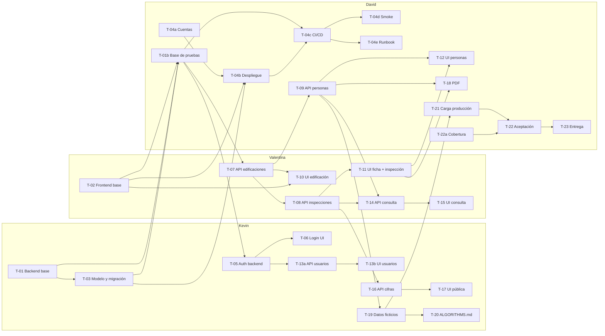

# TASKS.md — Plan de tareas del proyecto
> Índice de fases. El detalle de cada fase está en `specs/tasks/FASE-XX.md`.
> Convención: una tarea = una sesión de agente = una rama = un PR (atómica, verificable, independiente).
> Versión: **v1.2** — reparto entre 3 personas por módulo completo (DEC-011) · Última actualización: 2026-11-24

---

## Estado actual
> El avance diario se lleva en **GitHub Issues / Project** (§4). Kevin consolida esta sección al cerrar cada fase.

**Fase activa:** FASE-01 (configuración del despliegue y archivos compartidos)
**Hoy (24-nov):** Kevin → T-01, T-03 · Valentina → T-02 · David → T-04a, T-01b, T-04b

---

## 1. Fases del proyecto

| Fase | Nombre | Fechas | Archivo | Estado |
|---|---|---|---|---|
| FASE-00 | Documentación SDD | 21-oct – 24-nov | [`tasks/FASE-00.md`](tasks/FASE-00.md) | 🔄 |
| FASE-01 | **Configuración del despliegue** y archivos compartidos | 24-nov (mañana) | [`tasks/FASE-01.md`](tasks/FASE-01.md) | ⬜ |
| FASE-02 | Autenticación y usuarios | 24-nov (tarde) – 25-nov | [`tasks/FASE-02.md`](tasks/FASE-02.md) | ⬜ |
| FASE-03 | Registro: edificaciones, inspecciones y personas | 24-nov (tarde) – 26-nov | [`tasks/FASE-03.md`](tasks/FASE-03.md) | ⬜ |
| FASE-04 | Consulta, área pública y PDF | 26 – 27-nov | [`tasks/FASE-04.md`](tasks/FASE-04.md) | ⬜ |
| FASE-05 | Datos ficticios, calidad y entrega | 27 – 30-nov | [`tasks/FASE-05.md`](tasks/FASE-05.md) | ⬜ |

> Las fases ya no son secuenciales para todo el equipo: cada persona avanza por su columna del plan (§2) y solo espera en las dependencias marcadas.

---

## 2. Equipo y plan por persona

El día 1 se reparte **por capa** para crear la base y los archivos compartidos. Desde la tarde del día 1, cada persona toma **módulos completos** (backend + frontend + pruebas), para no esperar a nadie (DEC-011).

| Persona | Rol |
|---|---|
| **Kevin Vera** | Backend base, modelo de datos y migraciones, autenticación y usuarios, área pública, datos ficticios. Consolida los specs al cerrar cada fase |
| **Valentina Sepúlveda** | Frontend base; edificaciones (**implementación de referencia**), inspecciones y consulta |
| **David Calambas** | Infraestructura, despliegue y pruebas (**dueño de las cuentas** de Supabase, Render y Vercel); personas y PDF; aceptación y entrega |

| Día | Kevin Vera | Valentina Sepúlveda | David Calambas |
|---|---|---|---|
| **24-nov mañana** | T-01 backend base · T-03 modelo y migración | T-02 frontend base | T-04a cuentas · T-01b base de pruebas · T-04b despliegue |
| **24-nov tarde** | T-05 + T-06 autenticación | T-07 + T-10 edificaciones *(referencia)* | T-04c CI/CD · T-04d *smoke* · T-04e runbook |
| **25-nov** | T-13a + T-13b usuarios | T-08 + T-11 inspecciones y ficha | T-09 + T-12 personas |
| **26-nov** | T-16 + T-17 área pública | T-14 + T-15 consulta con filtros | T-18 PDF |
| **27-nov** | T-19 datos ficticios · T-20 algoritmos | Corrección de errores y apoyo | T-21 carga en producción · T-22a cobertura |
| **28-nov** | T-22 aceptación (los tres) y correcciones | ← | ← |
| **29-nov** | Congelamiento · T-23 (David) | ← | ← |
| **30-nov** | **Entrega** | ← | ← |

**Combinadas:** las parejas "T-07 + T-10" son la API y la interfaz del mismo módulo, de la misma persona. Pueden ir en un PR o en dos seguidos (CODING-STANDARDS §4).

---

## 3. Mapa de dependencias

**Dependencias entre personas que hay que vigilar** (si se atrasan, bloquean a otro):

| Quién espera | Qué necesita | De quién | Para cuándo |
|---|---|---|---|
| Valentina y David | T-03 modelo y T-01b `as_user` | Kevin / David | 24-nov a mediodía |
| David (T-09) | T-07 edificaciones fusionada | Valentina | 24-nov noche |
| Valentina (T-14) | T-09 personas fusionada | David | 25-nov noche |
| David (T-18) | T-11 ficha fusionada | Valentina | 25-nov noche |
| Kevin (T-19) | T-09 personas fusionada | David | 25-nov noche |

---

## 4. Coordinación

### 4.1 GitHub Issues y Project
- **Un issue por tarea** (`T-XX — nombre`), asignado a su responsable y con la etiqueta de su fase
- **Project** con columnas *Pendiente → En progreso → En revisión → Hecho*. Mover la tarjeta es la forma de reportar el avance; **no** se edita el estado en `TASKS.md` ni en `FASE-XX.md` (CLAUDE.md)
- Una persona solo trabaja en issues asignados a sí misma

### 4.2 Flujo de una tarea
1. `git checkout main && git pull` → rama `feat/T-XX-…`
2. Abrir el PR en **borrador** apenas haya un primer commit (los demás ven qué archivos tocas)
3. Implementar con Claude siguiendo CLAUDE.md y CODING-STANDARDS
4. `git pull --rebase origin main`, lint y pruebas en local, `/code-review`
5. Marcar el PR como listo y pedir revisión a **otra** persona del equipo
6. Fusionar (*merge commit*) y borrar la rama. El despliegue y el *smoke* son automáticos

### 4.3 Reglas
- **Máximo 1 PR abierto por persona** (2 si uno está esperando revisión)
- **Revisión en menos de 2 horas** en horario de trabajo: un PR esperando bloquea a otro
- **Archivos compartidos** (CODING-STANDARDS §3): solo se agregan líneas al final, en un PR pequeño y propio, avisando antes en el grupo
- **Migraciones:** solo Kevin
- **Dos sesiones en paralelo por persona, como máximo**, cada una en su propio *worktree* (`git worktree add ../edr-T-XX feat/T-XX-…`) y con tareas sin archivos en común
- Pruebas obligatorias y cobertura mínima en CI (TESTING §5): 80 % global, 90 % en `app/services/`
- Si una tarea se bloquea más de medio día, se avisa en el grupo y se replanifica

### 4.4 Reuniones
| Cuándo | Duración | Contenido |
|---|---|---|
| Mañana | 15 min | Qué toma cada uno hoy y qué archivo compartido va a tocar |
| Noche | 15 min | Qué se fusionó, qué está bloqueado, quién revisa qué |

---

## Leyenda de estado

| Símbolo | Significado |
|---|---|
| ⬜ | Pendiente |
| 🔄 | En progreso |
| ✅ | Completada |
| ⏸ | Bloqueada (esperando dependencia) |

---

## Completadas
Ver `tasks/FASE-00.md`.
