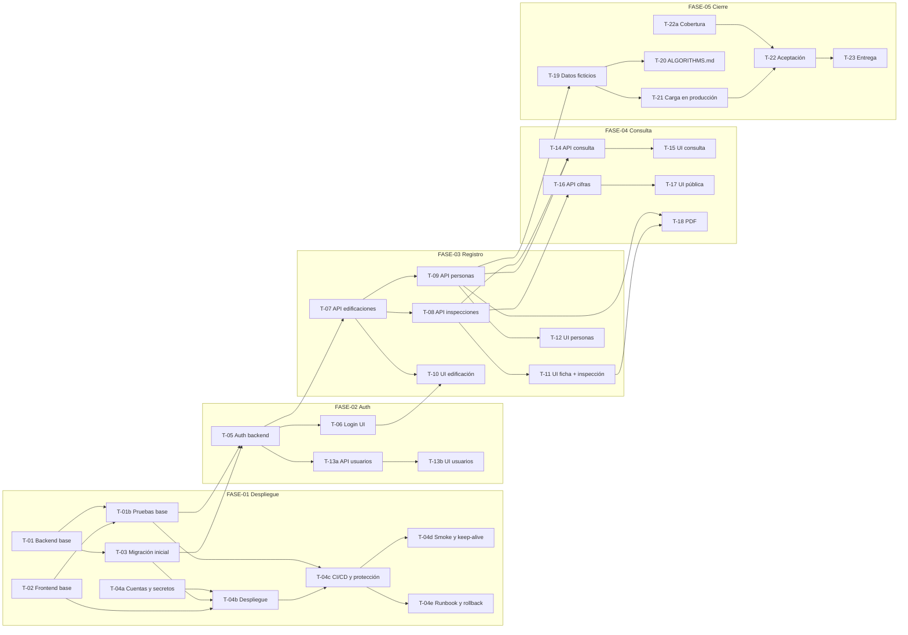

# TASKS.md — Plan de tareas del proyecto
> Índice de fases. El detalle de cada fase está en `specs/tasks/FASE-XX.md`.
> Convención: una tarea = una sesión de agente = una rama = un PR (atómica, verificable, independiente).
> Versión: **v1.1** — agrega la fase de configuración del despliegue (FASE-01) y la estrategia de pruebas (`arch/TESTING.md`) · Última actualización: 2026-11-23

---

## Estado actual

**Tarea activa:** —
**Fase activa:** FASE-00 (documentación SDD) → cierre
**Próxima tarea:** T-01 Esqueleto del backend y T-02 Esqueleto del frontend (FASE-01, en paralelo)

---

## Fases del proyecto

| Fase | Nombre | Fechas | Archivo | Estado |
|---|---|---|---|---|
| FASE-00 | Documentación SDD | 21-oct – 23-nov | [`tasks/FASE-00.md`](tasks/FASE-00.md) | 🔄 |
| FASE-01 | **Configuración del despliegue a producción** (esqueletos, pruebas, CI/CD) | 24-nov (mañana) | [`tasks/FASE-01.md`](tasks/FASE-01.md) | ⬜ |
| FASE-02 | Autenticación y usuarios | 24-nov (tarde) – 25-nov | [`tasks/FASE-02.md`](tasks/FASE-02.md) | ⬜ |
| FASE-03 | Registro: edificaciones, inspecciones y personas | 25 – 26-nov | [`tasks/FASE-03.md`](tasks/FASE-03.md) | ⬜ |
| FASE-04 | Consulta, área pública y PDF | 27-nov | [`tasks/FASE-04.md`](tasks/FASE-04.md) | ⬜ |
| FASE-05 | Datos ficticios, calidad y entrega | 28 – 30-nov | [`tasks/FASE-05.md`](tasks/FASE-05.md) | ⬜ |

---

## Carriles de trabajo (6 integrantes)
Cada integrante toma un carril para trabajar en paralelo sin pisarse. Los nombres se asignan en la reunión del equipo.

| Carril | Responsable | Tareas |
|---|---|---|
| **A — Backend núcleo** | *por asignar* | T-01, T-07, T-08, T-14 |
| **B — Backend personas y auth** | *por asignar* | T-05, T-13a, T-09, T-16, T-18 |
| **C — Frontend registro** | *por asignar* | T-02, T-10, T-11 |
| **D — Frontend consulta y público** | *por asignar* | T-06, T-13b, T-12, T-15, T-17 |
| **E — Infraestructura y despliegue** | *por asignar* (dueño de las cuentas, BRIEF P-02) | T-03, T-04a – T-04e, T-21, T-23 |
| **F — Pruebas, datos y documentación** | *por asignar* | T-01b, T-19, T-20, T-22a, T-22, revisión de PR |

> Si el carril B se retrasa, T-18 (PDF) pasa al carril F.

## Mapa de dependencias

## Reglas de trabajo
- Rama `feat/T-XX-descripcion` desde `main`; PR con CI en verde y **una** aprobación de otro integrante. Desde T-04c, GitHub lo exige
- **Pruebas obligatorias** (TESTING §5): toda tarea que toca `backend/app/` entrega pruebas unitarias de sus servicios y de integración de sus endpoints; toda tarea que toca `frontend/src/lib/` entrega pruebas con Vitest. Sin pruebas no se aprueba el PR
- **Cobertura mínima** en CI: 80 % global y 90 % en `app/services/`
- Al fusionar en `main`, el cambio se despliega solo; el *smoke* (T-04d) debe quedar en verde. Si falla, se revierte primero y se investiga después (INFRA §7.4)
- El PR referencia los RF/RN que cubre (p. ej. "Cubre RF-02-02, RN-01")
- Al fusionar: marcar la tarea ✅ en su `FASE-XX.md` y actualizar "Estado actual" de este archivo
- Si una tarea se bloquea más de medio día, se avisa en el grupo y se replanifica

---

## Leyenda de estado

| Símbolo | Significado |
|---|---|
| ⬜ | Pendiente |
| 🔄 | En progreso |
| ✅ | Completada |
| ⏸ | Bloqueada (esperando dependencia) |

---

## Completadas
Ver `tasks/FASE-00.md`.
