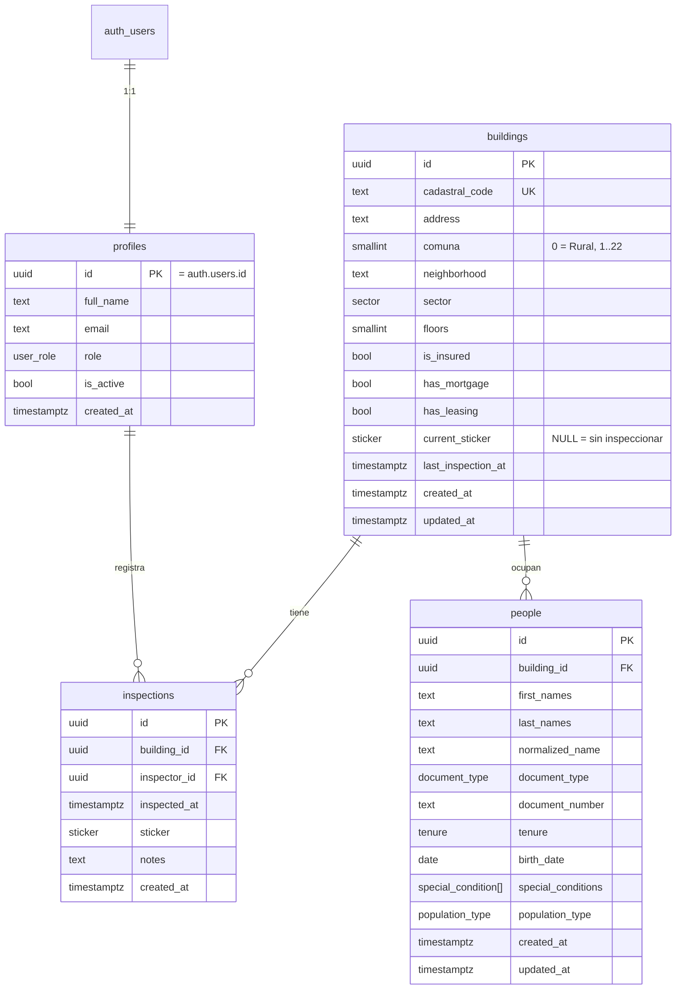

# DATA-MODEL.md — Modelo de datos
> BRIEF §8 y §10 · PRD MOD-01 a MOD-03 · Motor: PostgreSQL (Supabase)

---

## 1. Diagrama

---

## 2. Catálogos (tipos `ENUM` de PostgreSQL y `enums.py`)
Los valores se guardan en inglés (código); las etiquetas en español viven en el frontend y en el PDF.

| Enum | Valores → etiqueta |
|---|---|
| `user_role` | `admin` Administrador · `inspector` Inspector |
| `sector` | `housing` Vivienda · `commercial` Comercial · `health` Salud · `education` Educación · `infrastructure` Infraestructura · `logistics` Logística y suministros · `economy` Economía |
| `sticker` | `green` Verde · `yellow` Amarillo · `red` Rojo |
| `document_type` | `cc` Cédula de ciudadanía · `ti` Tarjeta de identidad · `rc` Registro civil · `ce` Cédula de extranjería · `passport` Pasaporte · `none` Sin documento |
| `tenure` | `owner` Propietario · `tenant` Arrendatario |
| `special_condition` | `disability` Discapacidad · `vulnerable` Persona vulnerable · `special_need` Necesidad especial |
| `population_type` | `civilian` Civil · `military` Militar · `prison` Carcelaria |

- **Comuna:** entero `0..22`; `0` = Rural. Catálogo de nombres en el frontend
- **Condición "Ninguna"** = arreglo vacío `{}`. No es un valor del enum: así "Ninguna" no puede convivir con otra condición (RF-03-01 CA-3) por construcción
- **Rango etario** no se guarda (ver §4)

---

## 3. Restricciones e índices

| Tabla | Restricción / índice | Implementa |
|---|---|---|
| `buildings` | `UNIQUE (cadastral_code)` | RN-01 |
| `buildings` | `CHECK (floors >= 1)`, `CHECK (comuna BETWEEN 0 AND 22)` | RF-02-02 |
| `buildings` | índices en `comuna`, `current_sticker`, `last_inspection_at`, `sector` | Filtros RF-04-01 |
| `inspections` | `FK building_id ON DELETE RESTRICT`, `FK inspector_id ON DELETE RESTRICT` | RN-02 (no se pierde historial) |
| `inspections` | índice `(building_id, inspected_at DESC)` | Historial |
| `inspections` | `CHECK (inspected_at >= '2026-08-10')` | RF-02-04 CA-2 (la cota "no futura" se valida en el backend) |
| `people` | `UNIQUE (building_id, document_type, document_number) WHERE document_type <> 'none'` | RN-06 con documento |
| `people` | `UNIQUE (building_id, normalized_name, birth_date) WHERE document_type = 'none'` | RN-06 sin documento |
| `people` | `CHECK ((document_type = 'none') = (document_number IS NULL))` | RF-03-01 CA-2 |
| `people` | `FK building_id ON DELETE CASCADE`; índices en `building_id`, `birth_date` | Filtros de personas |
| todas | RLS activado, sin políticas | ARCHITECTURE P-2 |

`normalized_name` = `first_names + ' ' + last_names` en minúsculas, sin tildes y con espacios colapsados; lo calcula el backend (`services/people.py`) al crear o editar.

> **Por qué índices únicos y no solo validación en el backend:** el índice es la estructura que hace la búsqueda O(log n) (B-tree) y además evita la condición de carrera de dos inserciones simultáneas. El backend traduce la violación (`IntegrityError`) a `409 Conflict`. Es uno de los dos casos del análisis algorítmico (BRIEF §13).

---

## 4. Datos derivados

### 4.1 Sticker vigente (RN-02) — desnormalizado
`buildings.current_sticker` y `buildings.last_inspection_at` se actualizan **en la misma transacción** que inserta una inspección, solo si `inspected_at >= last_inspection_at` (o es la primera).

- Las inspecciones son inmutables (PRD §2), así que el valor nunca queda desactualizado
- Alternativa descartada: calcularlo con `DISTINCT ON`/`LATERAL` en cada consulta. Es correcto pero complica cada filtro y cada conteo público. Ver DEC-005

### 4.2 Edad y rango etario (RN-07) — calculados, nunca guardados
- **Al mostrar:** `age = años completos entre birth_date y hoy` (`services/ages.py`)
- **Al filtrar:** el rango se traduce a un intervalo de `birth_date`, que usa el índice:

| Rango | Condición sobre `birth_date` (hoy = `t`) |
|---|---|
| 0–9 | `birth_date > t − 10 años` |
| 10–17 | `t − 18 años < birth_date <= t − 10 años` |
| 18–59 | `t − 60 años < birth_date <= t − 18 años` |
| 60+ | `birth_date <= t − 60 años` |

- **Al contar (área pública):** `GROUP BY` sobre un `CASE` con las mismas condiciones

### 4.3 Número de personas por edificación
Subconsulta `COUNT` agrupada en el listado de la consulta (RF-04-02 CA-1). No se desnormaliza.

---

## 5. Migraciones
- Alembic, una migración por cambio de esquema, en `backend/alembic/versions/`
- La migración inicial crea enums, tablas, índices y activa RLS
- `profiles.id` referencia `auth.users(id) ON DELETE CASCADE`; Alembic **no** gestiona el esquema `auth`
